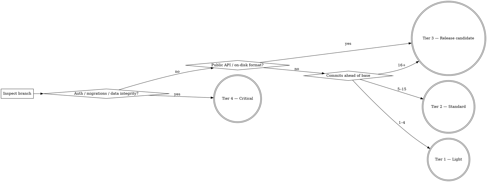

# Tiered Local Review

## Overview

Match review depth to change risk. Run local skills only. Compensate for cloud cold-context with `/second-opinion` (different model family) and a fresh-session pattern for the most critical work.

**Hard rule: never propose `/ultrareview`.** This preference is durable across all projects.

## Tier Selection

**Procedure:**

1. Run `git diff --stat $(git merge-base HEAD <base>)..HEAD` (base is usually `main` — read from project config if non-standard). Count commits, files, lines.
2. Classify per the flowchart above.
3. State the proposed tier with one-line reasoning to the user. Offer override via `AskUserQuestion` if it sits on a boundary (e.g. 15 commits, security-adjacent code).
4. Wait for confirmation before executing the playbook. Never auto-execute.

## Tier Playbooks

**Pre-step for every tier:** `simplify` runs first. Never review pre-simplify code — refactor will invalidate the review.

### Tier 1 — Light (1–4 commits, no sensitive surface)

1. Project's test gate passes
2. `simplify`
3. `commit` + push

No dedicated review step.

### Tier 2 — Standard (5–15 commits, normal feature work)

1. Tests pass
2. `simplify`
3. Dispatch one Task agent with `find-bugs` skill, scoped to the diff
4. `/second-opinion` on the diff
5. `fp-check` on candidate findings; drop FALSE_POSITIVEs
6. Apply true-positives; re-run project test + lint gates
7. `commit` → `pr-writer`, then address review comments on the PR directly

### Tier 3 — Release candidate (16+ commits OR public API / on-disk format)

1. Tests pass
2. `simplify`
3. Local fan-out — 4–6 specialists in parallel, dispatched per the router in
   `~/.claude/model-routing-policy.md` (pinned role agents, disjoint write sets,
   findings returned to the root which writes):
   - `differential-review` on full diff
   - `find-bugs` (general bug hunt)
   - `security-review` (input handling, secrets, auth)
   - Task agent: test-coverage gaps in the diff
   - Task agent: convention compliance (project CLAUDE.md, repo patterns)
   - Task agent (optional): performance review of hot paths
4. `fp-check` on every candidate finding; drop FALSE_POSITIVEs
5. `/second-opinion` — single invocation; the skill picks the highest-priority provider from `~/.claude/second-opinion.config.json` (currently `agy` first, then `codex`, then `gemini-cli`). One run satisfies Tier 3 per global CLAUDE.md.
6. **Adversarial re-run**: one more Task agent framed as "assume there's a bug here, find it"
7. Apply true-positives; re-run project test + lint gates
8. `commit` → `pr-writer` → release sequence (version bump → tag → publish) per project conventions

### Tier 4 — Critical (auth, migrations, data integrity, irreversible state)

Everything in Tier 3 plus:

1. Property-based tests added BEFORE the review (`property-based-testing` skill) — explores input space, catches what review reads-by reads can't
2. **Fresh-session pattern**: close current Claude Code session, open a new one, then run the Tier 3 pipeline. Purges the conversation context that primed the agent on the implementation — closest local approximation to fully cold context.
3. `/second-opinion` invoked once (provider order per `~/.claude/second-opinion.config.json`); per global CLAUDE.md, one run satisfies Tier 4. Only invoke a second provider if the user explicitly asks for parallel cold-context confirmation.
4. Don't combine with other risky changes in the same release; keep the blast radius narrow

## Hard Rules

- **Never propose `/ultrareview`.** Use local pipeline + `/second-opinion`.
- **`simplify` before review**, never after.
- **`fp-check` every candidate** before reporting it as a real bug. Cuts the bias toward over-fixing.
- **Project lint + test gates are mandatory** at every tier. Honor any project-specific memory entries (e.g. "ruff + pytest before push").
- **Confirm tier with user** before executing the playbook. Auto-classify, never auto-execute.

## Quick Reference

| Tier | Trigger | Skill sequence | Wall clock |
|---|---|---|---|
| 1 | 1–4 commits, safe | simplify | <2 min |
| 2 | 5–15 commits | simplify + find-bugs + /second-opinion + fp-check | 5–10 min |
| 3 | 16+ commits or API/format change | simplify + parallel fan-out + fp-check + /second-opinion + adversarial pass | 15–25 min |
| 4 | Auth/migrations/critical | Tier 3 + property tests + fresh session + /second-opinion (one run; second provider only on request) | 25–40 min |

## Common Mistakes

- **Running review before simplify** — wastes work; simplify will reshape the code.
- **Skipping fp-check** — surfaces false-positives as bugs, biases user toward over-fixing.
- **Auto-executing without confirming tier** — user should have the chance to override (e.g. "this is a 3-commit fix but it touches auth — bump to Tier 4").
- **Skipping `/second-opinion` at Tier 3+** — it's the only true cold-context source in this workflow; without it, the review is just my biased subagents.
- **Proposing `/ultrareview`** — see hard rule. Durable preference across all projects.

## Red Flags — STOP

- About to suggest `/ultrareview` → use this skill's pipeline instead
- About to skip `simplify` because "the code looks clean" → run it anyway
- About to skip `fp-check` because "the finding looks obvious" → run it anyway
- About to execute a tier's playbook without user confirmation of the tier → ask first
